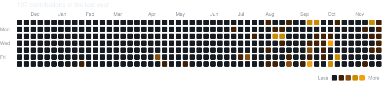

<!--
====================================================================
  GitHub Profile README  —  github.com/ybenyedder
====================================================================
-->

<!-- ============ HEADER ============ -->

  

<!-- ============ TYPING ABOUT ============ -->

  

<!-- ============ TECH STACK ============ -->

  
  
  
  
  
  
  
  

  
  
  
  
  
  
  

 

### ⚡ Featured Work

> **Volt Extension** — Chrome Manifest V3 toolkit (**50k+ downloads**) with async injection, heuristic monitoring, realtime chat & WebGL tooling (**9.1/10** security & architecture audit).

<table>
  <tr>
    <td width="50%" valign="top">
      <a href="https://github.com/ybenyedder/auralis"><b>🎵 auralis</b></a> 
      Self-hosted, local-first music & karaoke platform across web, desktop & Android.
    </td>
    <td width="50%" valign="top">
      <a href="https://github.com/ybenyedder/flix"><b>🎬 flix</b></a> 
      100% offline self-hosted media server for web, desktop & Android TV.
    </td>
  </tr>
  <tr>
    <td width="50%" valign="top">
      <a href="https://github.com/ybenyedder/freeboard"><b>⌨️ freeboard</b></a> 
      100% offline Android keyboard + AES-256-GCM encrypted Android↔Linux clipboard.
    </td>
    <td width="50%" valign="top">
      <a href="https://github.com/ybenyedder/SensorGuard"><b>🛡️ SensorGuard</b></a> 
      System-level Android camera & microphone blocker without root.
    </td>
  </tr>
  <tr>
    <td width="50%" valign="top">
      <a href="https://github.com/ybenyedder/LLMProvider"><b>🧠 LLMProvider</b></a> 
      On-device Android LLM provider service powered by <code>llama.cpp</code> (C++ / JNI).
    </td>
    <td width="50%" valign="top">
      <a href="https://github.com/ybenyedder/volt-maps"><b>🌐 volt-maps</b></a> 
      100% local offline mirror of the Reborn WebGL player — open source, zero telemetry.
    </td>
  </tr>
</table>

 

### 📊 GitHub Stats

  
  

### 📈 Contribution Graph

  

### 💭 Dev Quote

  

### 🌐 Find me

  
  

---

<i>⚡ From <a href="https://github.com/ybenyedder">Volt</a> · <a href="https://github.com/ybenyedder?tab=repositories">ybenyedder</a></i>

